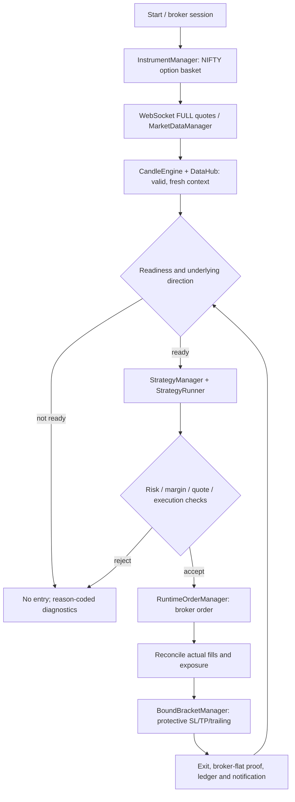

# NIFTY Scalper Bot

Python-based intraday **NIFTY CE/PE option buying** system using Zerodha Kite market data and execution. NIFTY spot/futures provide market context, **not tradable instruments**.

> **Repository is the code/configuration source of truth.** AWS Lightsail runs a validated GitHub revision; host-local secrets and broker/account state are never committed. A merged commit is **not** proof of production activation—verify the deployed SHA and health separately.

## Trading lifecycle at a glance



Protective exits and reconciliation continue independently of new-entry approval. Broker-confirmed fills/positions—not requests or local acknowledgements—control exposure. Any ambiguous broker state must block **new** entries without suppressing protective exits.

## Start here

| Read | Where | Purpose |
| --- | --- | --- |
| **System lifecycle** | [docs/TRADING_LIFECYCLE.md](docs/TRADING_LIFECYCLE.md) | Trading, order/exit, restart/deployment flow and failure boundaries |
| **Canonical trading owners** | [ARCHITECTURE_TRADING_PATH.md](ARCHITECTURE_TRADING_PATH.md) | Actual runtime authorities and hand-offs |
| **Machine-readable architecture SSOT** | [agent_manifest.json](docs/architecture/agent_manifest.json) | Runtime path, ownership and validation routing |
| **Module navigation** | [docs/REPO_MAP.md](docs/REPO_MAP.md) | Find the relevant module, tests and owner |
| **Documentation maintenance** | [docs/MODULE_DOCUMENTATION.md](docs/MODULE_DOCUMENTATION.md) | File-header convention, synchronization and CI guard |
| **Engineering instructions** | [AGENTS.md](AGENTS.md) | Safety invariants and change discipline |
| **Operational runbooks** | [RUNBOOK.md](RUNBOOK.md), [Lightsail setup](deploy/LIGHTSAIL_SETUP.md) | Operator/deployment procedures |
| **Agent workflow** | [docs/CHATGPT_CODE_WORKFLOW.md](docs/CHATGPT_CODE_WORKFLOW.md) | Draft PR, validation, release verification |

## Key boundaries

- **Data:** `InstrumentManager` selects symbols; `MarketDataManager` owns live quote/history quality and subscriptions; `CandleEngine` constructs bars; `DataHub` is a read facade.
- **Decision:** `StrategyManager` establishes underlying direction; `StrategyRunner` evaluates candidate option entries. Missing/stale evidence fails closed.
- **Money:** `RiskManager` sizes/limits; `RuntimeOrderManager` owns final broker submission; `PositionManager` reconciles exposure; `BoundBracketManager` manages protective exits. Do not create alternate order paths.
- **Operations:** `main.py` hosts HTTP health/status; Telegram and Streamlit provide operator surfaces but do not independently own strategy state.
- **Deployment:** GitHub `main` is the code release source; the Lightsail updater must validate candidate code and verify the active process after deployment. See the runbook for hold/rollback behavior.

## Development and checks

```bash
python -m pip install -e '.[dev]'
python scripts/module_doc_guard.py --all
python scripts/agent_task.py check --files src/nifty_scalper_bot/strategies/runner.py
python scripts/agent_task.py full --files src/nifty_scalper_bot/strategies/runner.py
```

Every material change must review (1) the module's opening description, (2) relevant lifecycle/architecture docs, and (3) tests. The documentation guard is enforced by CI and checks module coverage and interface/header drift; reviewers must still check **semantic** accuracy. No test command above places a live broker order.

**Security:** never commit broker keys, access tokens, `.env`, accounts, or live operational data. Runtime status is not inferred from this README.
