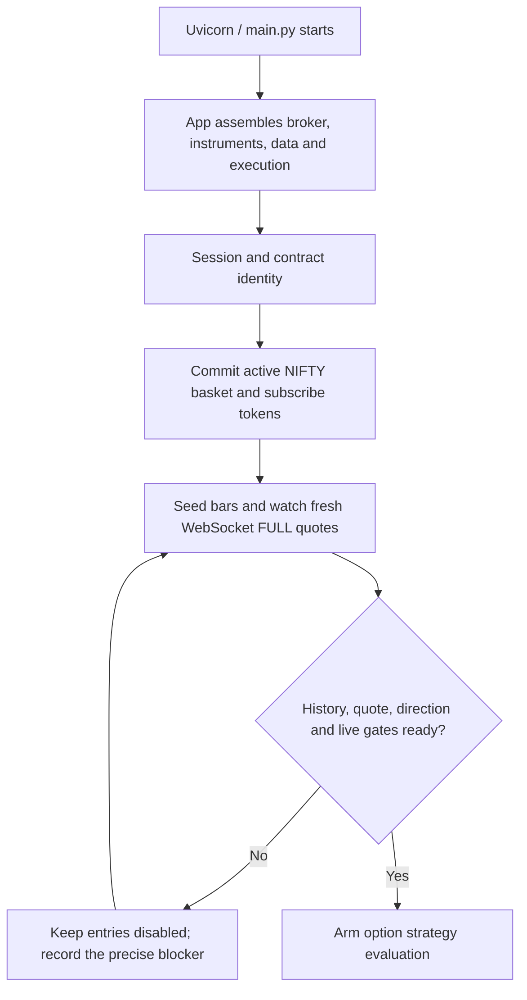
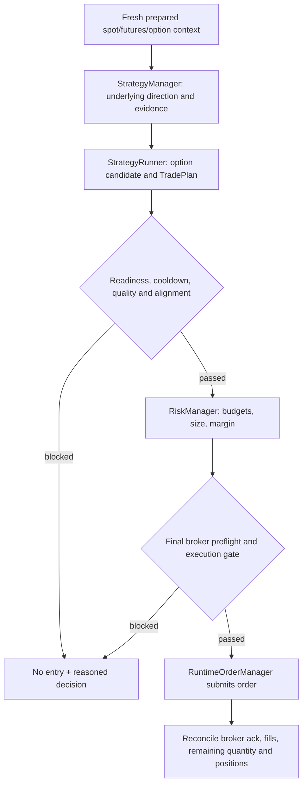
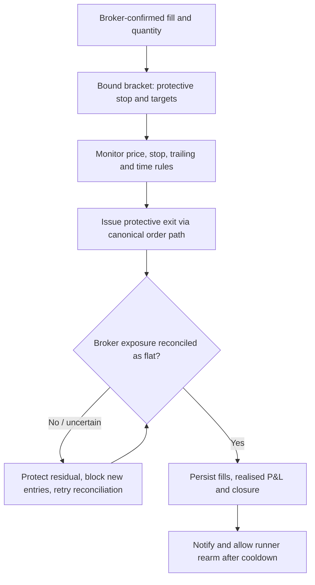
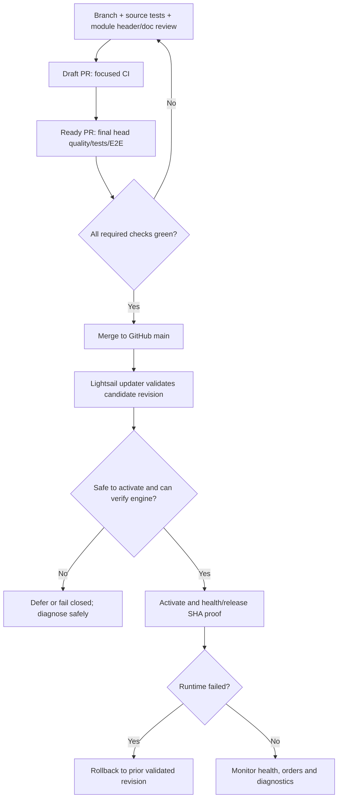

# NIFTY trading lifecycle — reader's guide

This page explains **what happens** in order. For exact ownership and production class paths, use [the canonical trading path](../ARCHITECTURE_TRADING_PATH.md) and its machine-readable [manifest](architecture/agent_manifest.json). Avoid copying owner lists into additional files.

## 1. Startup / readiness

The active instrument basket is selected by InstrumentManager, committed by App and consumed by downstream modules. Do not select contracts independently in strategies/execution. WebSocket FULL data remains preferred; degraded REST or synthetic values cannot silently acquire fresher-source authority. A successful HTTP response alone does not prove trading readiness.

## 2. Signal and order admission

The direction decision uses fresh underlying spot/futures context, not option premium alone. A TradePlan is only intent: an accepted, partial, rejected, cancelled or timed-out order must be tracked explicitly. The single final order-submission point is the runtime order manager; no strategy or operator shortcut may bypass it.

## 3. Open trade / exit / recovery

Stops must never be loosened by a trailing update. Reconciliation must use broker-confirmed positions/fills as exposure truth; rejected or partial exits are not 'closed' states. Any ambiguous exposure blocks **new entries**, not protective reductions. Logs, Telegram, and dashboards report state; they do not own it.

**Ambiguous exit submissions:** A timeout or missing broker acknowledgement is not proof that an EXIT/REDUCE failed. OrderManager durably reserves the symbol *before* submitting the exit, preventing a second blind submission (even with a different tag or after process restart). There is no TTL-based release. Broker history including COMPLETE/partial orders, current positions, and the canonical bracket/protection ledger must be reconciled before an operator clears an uncertain reservation; never simply delete the persisted hold as a restart workaround. Confirmed existing stops remain under the bracket owner's control. If unresolved, alert the operator and keep the affected execution path held rather than risk an oversell. An acknowledged exit releases its reservation only after local order registration and PositionManager pending-order synchronization. The execution-health snapshot reports unresolved exit symbols and journal corruption.

## 4. Source-code change to production

**Two separate facts:** GitHub merged SHA and Lightsail effective runtime SHA. Verify both; never report successful live activation based solely on a merge or HTTP connection failure. Consult [Lightsail setup](../deploy/LIGHTSAIL_SETUP.md), [deployment runbook](ops/nifty_single_path_runbook.md), and the [canonical trading path](../ARCHITECTURE_TRADING_PATH.md) for actual current policies including restart holds and rollback. Host secrets and operational data remain outside GitHub; the production host should not fork business logic.

## Where to investigate

| Symptom | Investigate first |
| --- | --- |
| Missing option/incorrect strike | Contract/basket selection and symbol-token mapping |
| Stale quote or missing option bars | WebSocket → MDM → CandleEngine → DataHub |
| No entry despite valid data | Direction evidence → runner setup → risk → execution gate, in that order |
| Duplicate, partial or rejected entry | Order idempotency, broker order statuses, fill reconciliation |
| Stop/trailing/exit discrepancy | Bound bracket, exit order path, position reconciliation |
| GitHub change not live | Merged SHA, candidate validator, updater hold, `/releasez`, rollback status |

Use [repository navigation](REPO_MAP.md) for path/test lookup. Detailed reasons/parameters belong in the owner module, configuration, code tests or appropriate runbook—not in a second master list.
